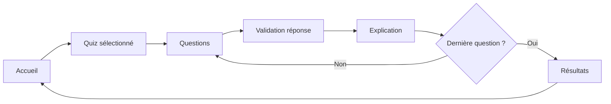

# Documentation Technique CQCM

## Vue d'ensemble

CQCM est une application Flutter de quiz. L'utilisateur choisit un quiz, répond aux questions, valide ses réponses, puis consulte un score et une correction détaillée.

Le projet supporte deux sources de données :

- les quiz embarqués dans `assets/data/`, disponibles dès le build ;
- les quiz runtime importés depuis un package JSON, sans rebuild.



## Architecture

```text
lib/
  main.dart
  models/
    quiz.dart
    question.dart
  screens/
    home_screen.dart
    quiz_screen.dart
    result_screen.dart
  services/
    quiz_service.dart
    runtime_quiz_store.dart
    runtime_quiz_store_io.dart
    runtime_quiz_store_stub.dart
  widgets/
    markdown_text.dart
    option_tile.dart
    progress_bar.dart
    quiz_card.dart
```

### Responsabilités

`QuizService` charge les quiz et questions. Il lit d'abord les assets Flutter, puis superpose les quiz runtime quand un dossier runtime est disponible.

`runtime_quiz_store_io.dart` gère le stockage local, l'import JSON, la validation du package et l'écriture des fichiers runtime.

`runtime_quiz_store_stub.dart` fournit une version neutre pour les plateformes où `dart:io` n'est pas disponible.

`HomeScreen` affiche le catalogue, groupe les quiz par catégorie et expose le bouton d'import JSON.

`QuizScreen` pilote la sélection, la validation et l'avancement dans les questions.

`ResultScreen` affiche le score et la correction détaillée.

## Données embarquées

Le catalogue principal est :

```text
assets/data/data.json
```

Chaque entrée de catalogue pointe vers un fichier de questions :

```json
{
  "id": "qualite-tests-junit",
  "title": "Qualité dev – Tests et JUnit",
  "description": "V&V, vocabulaire, processus de test...",
  "category": "Qualité",
  "difficulty": "intermediaire",
  "questionCount": 50,
  "fileName": "questions-qualite-tests-junit.json",
  "icon": "🧪"
}
```

Ces fichiers sont déclarés dans `pubspec.yaml` :

```yaml
flutter:
  assets:
    - assets/data/
```

Important : les assets sont empaquetés au build. Modifier `assets/data/` après compilation ne modifie pas une application déjà installée.

## Import JSON runtime

Le bouton d'import lit un package JSON complet :

```json
{
  "quiz": {
    "id": "mon-quiz",
    "title": "Mon quiz",
    "description": "Description courte",
    "category": "Import",
    "difficulty": "debutant",
    "questionCount": 2,
    "fileName": "questions-mon-quiz.json",
    "icon": "Q"
  },
  "questions": [
    {
      "id": 1,
      "question": "Question à choix unique ?",
      "options": ["A", "B"],
      "correctIndex": 0,
      "explanation": "A est correcte."
    },
    {
      "id": 2,
      "question": "Question à choix multiples ?",
      "options": ["A", "B", "C"],
      "correctIndices": [0, 2]
    }
  ]
}
```

### Règles de validation

- `quiz.id` et `quiz.title` ne doivent pas être vides.
- `quiz.questionCount` doit être égal au nombre d'éléments dans `questions`.
- `questions` ne doit pas être vide.
- Chaque question doit avoir au moins deux options.
- Chaque question doit définir `correctIndex` ou `correctIndices`.
- Les index corrects doivent pointer vers des options existantes.
- Les identifiants de questions doivent être uniques dans un même quiz.

### Fichiers d'exemple

- `exemple_import.json` : template minimal.
- `test_import_5_questions.json` : fichier de test avec 5 questions.
- `test/fixtures/sample_quiz_package.json` : fixture utilisée pour les tests.

## CLI d'administration

La CLI est disponible dans :

```text
bin/cqcm_quiz.dart
```

Afficher l'aide :

```bash
dart run bin/cqcm_quiz.dart --help
```

Valider un package :

```bash
dart run bin/cqcm_quiz.dart validate --package exemple_import.json
```

Initialiser un dossier runtime :

```bash
dart run bin/cqcm_quiz.dart --dir cqcm-runtime-data init
```

Ajouter un quiz :

```bash
dart run bin/cqcm_quiz.dart --dir cqcm-runtime-data add-quiz --package exemple_import.json
```

Ajouter une question :

```bash
dart run bin/cqcm_quiz.dart --dir cqcm-runtime-data add-question \
  --quiz-id exemple-import \
  --question "Nouvelle question ?" \
  --option "Réponse A" \
  --option "Réponse B" \
  --correct-index 0
```

## Tests

Lancer toute la suite :

```bash
flutter test
```

Couverture fonctionnelle actuelle :

- modèles `Quiz` et `Question` ;
- chargement du catalogue et des questions ;
- cohérence entre `questionCount` et fichiers JSON ;
- chargement runtime ;
- composants UI principaux ;
- parcours accueil vers quiz.

## Build release

Compiler un APK release :

```bash
flutter build apk --release
```

Artefact attendu :

```text
build/app/outputs/flutter-apk/app-release.apk
```

## Décisions techniques

### Pourquoi un package JSON complet ?

Un package unique contenant `quiz` et `questions` évite les imports incomplets. L'application peut valider le lien entre métadonnées et questions avant d'écrire quoi que ce soit.

### Pourquoi garder les assets ?

Les assets donnent un catalogue de base fiable, disponible hors ligne et versionné avec l'application.

### Pourquoi ajouter un runtime store ?

Le runtime store permet d'ajouter ou remplacer des quiz sans rebuild. L'app garde donc un socle embarqué, mais peut évoluer localement.

### Limite mobile

Sur Android et iOS, une CLI locale ne peut pas modifier facilement les fichiers privés d'une application installée. Le bouton d'import intégré est donc le chemin recommandé pour les appareils mobiles.
