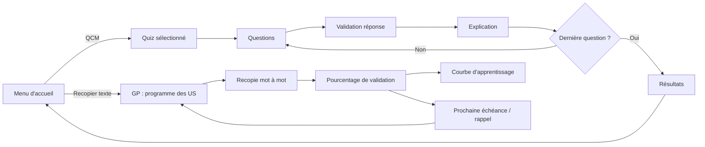

# Documentation Technique CQCM

## Vue d'ensemble

CQCM est une application Flutter de révision. L'écran d'accueil est un menu proposant deux modes :

- **QCM** : l'utilisateur choisit un quiz, répond aux questions, valide ses réponses, puis consulte un score et une correction détaillée ;
- **Recopier texte** : l'utilisateur recopie une phrase au mot près (programme GP – user stories), obtient un pourcentage de validation, et la phrase est replanifiée selon une courbe d'apprentissage.

Le projet supporte deux sources de données :

- les quiz embarqués dans `assets/data/`, disponibles dès le build ;
- les quiz runtime importés depuis un package JSON, sans rebuild.



## Architecture

```text
lib/
  main.dart
  models/
    quiz.dart
    question.dart
    revision.dart
    revision_progress.dart
  screens/
    main_menu_screen.dart
    quiz_catalog_screen.dart
    quiz_screen.dart
    result_screen.dart
    text_revision_screen.dart
    revision_session_screen.dart
  services/
    quiz_service.dart
    runtime_quiz_store.dart
    runtime_quiz_store_io.dart
    runtime_quiz_store_stub.dart
    text_scoring.dart
    revision_scheduler.dart
    revision_service.dart
    notification_plan.dart
    notification_service.dart
    notification_settings_store.dart
    revision_plan.dart
    revision_stats.dart
    revision_store.dart
    revision_store_io.dart
    revision_store_stub.dart
  widgets/
    markdown_text.dart
    option_tile.dart
    progress_bar.dart
    quiz_card.dart
    revision_chart.dart
    revision_reminder_banner.dart
    word_diff_view.dart
```

### Responsabilités

`QuizService` charge les quiz et questions. Il lit d'abord les assets Flutter, puis superpose les quiz runtime quand un dossier runtime est disponible.

`runtime_quiz_store_io.dart` gère le stockage local, l'import JSON, la validation du package et l'écriture des fichiers runtime.

`runtime_quiz_store_stub.dart` fournit une version neutre pour les plateformes où `dart:io` n'est pas disponible.

`MainMenuScreen` est l'écran d'accueil : il propose les deux modes et affiche le rappel de révision (nombre de phrases dues, prochaine échéance).

`QuizCatalogScreen` affiche le catalogue, groupe les quiz par catégorie et expose le bouton d'import JSON.

`text_scoring.dart` compare une copie et une réponse de référence mot à mot (normalisation, LCS, fautes de frappe, contraintes d'énoncé, structure de user story).

`revision_scheduler.dart` planifie les révisions espacées (intervalles, facteur de facilité, échéances).

`revision_plan.dart` assemble catalogue, progression et décisions de séance, et construit les rappels (`RevisionReminder`).

`revision_store_io.dart` / `revision_store_stub.dart` persistent la progression (`revision-progress.json`) et la configuration de notifications selon la plateforme. Sans dossier disponible (web, tests), la progression reste en mémoire pour la session ; sous `flutter test`, le dossier système n'est pas demandé.

`notification_plan.dart` transforme les échéances en rappels (`ReminderNotification`) datés ; `notification_service.dart` parle au plugin `flutter_local_notifications` (initialisation, autorisations, `zonedSchedule`, annulation) ; `notification_settings_store.dart` lit `assets/data/notifications.json` puis la surcharge locale.

`TextRevisionScreen` (écran « GP : ») affiche la courbe d'apprentissage, les statistiques et la liste des phrases ; `RevisionSessionScreen` pilote la recopie, la correction et le bilan de séance.

`QuizScreen` pilote la sélection, la validation et l'avancement dans les questions.

`ResultScreen` affiche le score et la correction détaillée.

## Données embarquées

Le catalogue principal est :

```text
assets/data/data.json
```

Chaque entrée de catalogue pointe vers un fichier de questions :

```json
{
  "id": "qualite-tests-junit",
  "title": "Qualité dev – Tests et JUnit",
  "description": "V&V, vocabulaire, processus de test...",
  "category": "Qualité",
  "difficulty": "intermediaire",
  "questionCount": 50,
  "fileName": "questions-qualite-tests-junit.json",
  "icon": "🧪"
}
```

### Programmes de recopie

Les programmes de révision suivent le même principe :

```text
assets/data/revision-decks.json    catalogue des programmes
assets/data/revision-gp-us.json    phrases du programme GP (user stories)
```

Un programme contient des phrases (`items`) avec un énoncé (`prompt`), des contraintes
éventuelles (`constraints`) et une ou plusieurs réponses de référence (`answers`). La
progression n'est pas embarquée : elle est écrite dans le stockage local (voir
`docs/mode-recopier-texte.md`).

Ces fichiers sont déclarés dans `pubspec.yaml` :

```yaml
flutter:
  assets:
    - assets/data/
```

Important : les assets sont empaquetés au build. Modifier `assets/data/` après compilation ne modifie pas une application déjà installée.

## Import JSON runtime

Le bouton d'import lit un package JSON complet :

```json
{
  "quiz": {
    "id": "mon-quiz",
    "title": "Mon quiz",
    "description": "Description courte",
    "category": "Import",
    "difficulty": "debutant",
    "questionCount": 2,
    "fileName": "questions-mon-quiz.json",
    "icon": "Q"
  },
  "questions": [
    {
      "id": 1,
      "question": "Question à choix unique ?",
      "options": ["A", "B"],
      "correctIndex": 0,
      "explanation": "A est correcte."
    },
    {
      "id": 2,
      "question": "Question à choix multiples ?",
      "options": ["A", "B", "C"],
      "correctIndices": [0, 2]
    }
  ]
}
```

### Règles de validation

- `quiz.id` et `quiz.title` ne doivent pas être vides.
- `quiz.questionCount` doit être égal au nombre d'éléments dans `questions`.
- `questions` ne doit pas être vide.
- Chaque question doit avoir au moins deux options.
- Chaque question doit définir `correctIndex` ou `correctIndices`.
- Les index corrects doivent pointer vers des options existantes.
- Les identifiants de questions doivent être uniques dans un même quiz.

### Fichiers d'exemple

- `exemple_import.json` : template minimal.
- `test_import_5_questions.json` : fichier de test avec 5 questions.
- `test/fixtures/sample_quiz_package.json` : fixture utilisée pour les tests.

## CLI d'administration

La CLI est disponible dans :

```text
bin/cqcm_quiz.dart
```

Afficher l'aide :

```bash
dart run bin/cqcm_quiz.dart --help
```

Valider un package :

```bash
dart run bin/cqcm_quiz.dart validate --package exemple_import.json
```

Initialiser un dossier runtime :

```bash
dart run bin/cqcm_quiz.dart --dir cqcm-runtime-data init
```

Ajouter un quiz :

```bash
dart run bin/cqcm_quiz.dart --dir cqcm-runtime-data add-quiz --package exemple_import.json
```

Ajouter une question :

```bash
dart run bin/cqcm_quiz.dart --dir cqcm-runtime-data add-question \
  --quiz-id exemple-import \
  --question "Nouvelle question ?" \
  --option "Réponse A" \
  --option "Réponse B" \
  --correct-index 0
```

## Mode recopier texte

Documentation complète : `docs/mode-recopier-texte.md`.

Points clés :

- tirage des phrases **au hasard** dans la séance (les phrases dues d'abord) ;
- 1 token = 1 mot ; ponctuation, casse et accents sont neutralisés ;
- chiffres et lettres séparés (`14h` = `14` + `h`) ; élision ramenée à son mot
  complet avec ou sans apostrophe (`d'acheter` = `d acheter` = `de acheter`) ;
- score de validation = mots justes / mots attendus, seuil **95 %** ;
- statut par mot : juste, manquant, en trop, faute de frappe ;
- structure de user story vérifiée (« En tant que… », « Je veux… », « Afin de… ») ;
- contraintes d'énoncé lues automatiquement (« ne pas utiliser le verbe X ») ;
- révisions espacées : J+1, J+3, J+7 puis intervalle × facteur de facilité (max 180 jours) ;
- échec : série remise à zéro, phrase à revoir le jour même ;
- rappels in-app : pastille sur le bouton du menu, bandeau avec bouton « Réviser »,
  prochaine échéance affichée ;
- rappels système : notifications programmées aux dates dues (`docs/notifications.md`).

### Notifications

Deux niveaux cohabitent :

1. **In-app** — `RevisionReminder` alimente `RevisionReminderBanner` et la pastille
   du menu (phrases dues, prochaine échéance).
2. **Système** — `NotificationPlan` regroupe les phrases dues par jour et
   `ReminderNotifications` programme les rappels via `flutter_local_notifications`
   (`zonedSchedule`), à l'heure fixée dans `assets/data/notifications.json`.

La configuration est **entièrement JSON** : défauts embarqués
(`assets/data/notifications.json`), surcharge locale
(`notifications.json` dans `<dossier de données>/cqcm-revision-data/`, ou
`CQCM_REVISION_DIR`), charge utile JSON attachée à chaque notification. L'écran
**Rappels** (cloche de la barre de titre) montre les réglages effectifs, le plan
calculé, les rappels enregistrés dans le système et permet de tester/synchroniser.

Synchronisation automatique : au chargement du menu d'accueil et après chaque
séance de révision. Détails, configuration Android/iOS et limites :
`docs/notifications.md`.

## Tests

Lancer toute la suite :

```bash
flutter test
```

Sortie lisible, une ligne par fichier, pour ne garder que ce qui compte :

```bash
dart run bin/test_summary.dart                    # toute la suite
dart run bin/test_summary.dart --details           # messages connus affichés
dart run bin/test_summary.dart test/app_flow_test.dart
```

Le script relance `flutter test --reporter json` et classe chaque fichier :

| Statut | Signification |
| --- | --- |
| `OK` | tout passe, aucun message |
| `OK (warning)` | tout passe, des messages connus ont été écrits (résumés, pas affichés) |
| `OK (error)` | tout passe, des erreurs attendues ont été signalées puis traitées par les tests |
| `KO` | au moins un échec — seul cas où le détail (erreur + test) est affiché |

Couverture fonctionnelle actuelle :

- modèles `Quiz` et `Question` ;
- chargement du catalogue et des questions ;
- cohérence entre `questionCount` et fichiers JSON ;
- chargement runtime ;
- composants UI principaux ;
- parcours menu vers catalogue puis quiz ;
- tokenisation et comparaison au mot près (`text_scoring_test.dart`) ;
- planification des révisions et statistiques (`revision_scheduler_test.dart`,
  `revision_stats_test.dart`) ;
- chargement du programme GP, enregistrement et persistance (`revision_plan_test.dart`) ;
- widgets du mode texte (`revision_widgets_test.dart`) ;
- parcours complet recopie depuis le menu (`revision_flow_test.dart`) ;
- réglages JSON des rappels et fusion des surcharges
  (`notification_settings_test.dart`) ;
- plan de rappels système, gabarits et plafond (`notification_plan_test.dart`) ;
- écran Rappels depuis le menu (`notifications_screen_test.dart`).

## Build release

Compiler un APK release :

```bash
flutter build apk --release
```

Artefact attendu :

```text
build/app/outputs/flutter-apk/app-release.apk
```

## Décisions techniques

### Pourquoi un package JSON complet ?

Un package unique contenant `quiz` et `questions` évite les imports incomplets. L'application peut valider le lien entre métadonnées et questions avant d'écrire quoi que ce soit.

### Pourquoi garder les assets ?

Les assets donnent un catalogue de base fiable, disponible hors ligne et versionné avec l'application.

### Pourquoi ajouter un runtime store ?

Le runtime store permet d'ajouter ou remplacer des quiz sans rebuild. L'app garde donc un socle embarqué, mais peut évoluer localement.

### Pourquoi un seuil de validation à 95 % ?

La consigne est de recopier « au mot près ». Un seuil à 100 % serait décourageant
(une seule faute de frappe invaliderait la phrase), un seuil à 90 % laisserait passer
l'oubli de plusieurs mots. À 95 %, une phrase de 17 mots tolère un mot manquant ou
erroné, mais pas deux.

### Pourquoi des notifications système en plus du bandeau in-app ?

Le bandeau ne sert que si l'application est ouverte : pour suivre la courbe
d'apprentissage, le rappel doit arriver même quand elle est fermée.
`flutter_local_notifications` est donc branché, mais uniquement derrière
`ReminderNotifications` : tous les appels sont encapsulés dans des `try/catch` et
la configuration vient d'un fichier JSON, si bien que l'application fonctionne
(avec les seuls rappels in-app) sur les plateformes non gérées — Linux pour la
planification, web — ou si le plugin échoue.

### Limite mobile

Sur Android et iOS, une CLI locale ne peut pas modifier facilement les fichiers privés d'une application installée. Le bouton d'import intégré est donc le chemin recommandé pour les appareils mobiles.
