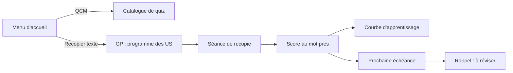

# Mode « Recopier texte » (GP)

Le mode « Recopier texte » fait réciter des phrases **au mot près**. Il est branché
derrière le bouton du menu d'accueil et contient aujourd'hui le programme **GP**
(user stories de gestion de projet) : 12 cas de boulangerie, notes des étudiants et EDT.

## Parcours



1. **Menu** : deux boutons, `QCM` et `Recopier texte`. le bouton texte affiche une
   pastille avec le nombre de phrases à réviser, et un bandeau de rappel
   sous les boutons.
2. **GP :** : l'écran « Recopier texte » affiche le rappel du jour, la courbe
   d'apprentissage, les statistiques, le lanceur de séance (3 / 5 / 10 / toutes
   les phrases) puis la liste des phrases groupées par projet.
3. **Séance** : on lit l'énoncé, on recopie la user story, on valide. La copie
   est comparée mot à mot à la réponse de référence. Les phrases de la séance
   sont tirées **au hasard** parmi celles à réviser ; si la séance est plus
   longue que le rappel du jour, elle est complétée par les phrases les moins
   maîtrisées (tirage au hasard à l'intérieur de chaque palier de maîtrise).
4. **Correction** : pourcentage de validation, mots manquants / en trop / fautes
   de frappe, contrôle de la structure (rôle, besoin, but), contrôle des
   contraintes d'énoncé, réponse officielle.
5. **Bilan** : moyenne de la séance, phrases validées, prochaine échéance, et
   proposition de refaire les phrases ratées.

## Comparaison « au mot près »

`lib/services/text_scoring.dart` définit **un token = un mot**.

- Normalisation : minuscules, accents ignorés (`récupérer` = `recuperer`),
  ponctuation et retours à la ligne ignorés.
- Chiffres et lettres forment des **mots séparés** : `14h` = `14` + `h`,
  `2TD` = `2` + `td`.
- Élisions ramenées à la forme complète, avec ou sans apostrophe :
  `qu'étudiant` = `que etudiant`, `d'acheter` = `d acheter` = `de acheter`.
- Alignement : plus longue sous-séquence commune (LCS) entre la copie et la
  réponse de référence.
- Statut de chaque mot : juste, manquant, en trop, faute de frappe
  (distance de Levenshtein ≤ 2 sur des mots proches).

Indicateurs produits :

| Indicateur | Définition |
| --- | --- |
| `% de validation` | mots justes / mots attendus |
| `précision` | mots justes / mots écrits |
| `similarité` | moyenne harmonique des deux |

Le **seuil de validation est 95 %** (`TextScorer.passThreshold`) : la recopie est
exigée au mot près, une ou deux approximations seulement passent (à l'échelle
d'une phrase de 17 mots, 94 % échoue et 95 % passe). Une copie validée est
marquée « recopie exacte » quand le score vaut 100 %.

Contraintes d'énoncé : les mentions « ne pas utiliser le verbe X » sont lues
automatiquement. Un mot interdit est signalé uniquement s'il apparaît dans la
copie **et** pas dans la réponse officielle. Exemple : pour
`us-boulangerie-2`, la réponse officielle contient « le montant à payer », le
contrôle est donc tolérant ; si l'élève écrit « je veux payer », l'avertissement
s'affiche.

## Révisions espacées et courbe d'apprentissage

`lib/services/revision_scheduler.dart` applique un algorithme dérivé de SM-2 :

- note de qualité déduite du taux de validation (100 % → 5, 95 % → 3, < 95 % → échec) ;
- réussite : les intervalles s'allongent (J+1, J+3, J+7, puis intervalle × facteur
  de facilité, plafonné à 180 jours) ;
- échec : la série retombe à zéro et la phrase revient le jour même ;
- le facteur de facilité monte avec les copies parfaites et descend avec les
  approximations (plancher 1,3).

La **courbe d'apprentissage** (`lib/widgets/revision_chart.dart`) trace le taux de
validation de chaque révision, sa moyenne glissante et la ligne de seuil à 95 %.
Les statistiques associées : taux moyen, dernière note, meilleure note, nombre de
révisions, phrases acquises (5 réussites consécutives), jours d'affilée.

## Rappels (notifications)

`RevisionReminder` (dans `lib/services/revision_plan.dart`) calcule, pour chaque
programme, le nombre de phrases à revoir aujourd'hui et la prochaine échéance.

Affichage :

- pastille sur le bouton « Recopier texte » du menu ;
- bandeau `RevisionReminderBanner` sur le menu et dans l'écran GP, avec le bouton
  « Réviser » qui démarre la séance des phrases dues ;
- étiquette « à réviser » sur chaque phrase concernée ;
- bandeau de fin de séance indiquant la prochaine date de révision.

Ces rappels sont **in-app**, mais ils sont complétés par de vraies
**notifications système** programmées avec `flutter_local_notifications` :
`NotificationPlan` transforme les échéances en rappels datés et
`ReminderNotifications` les enregistre auprès du système à l'heure définie dans
`assets/data/notifications.json`. La synchronisation a lieu au chargement du menu
d'accueil et après chaque séance, et reste débrayable depuis l'écran **Rappels**
(cloche de la barre de titre). Configuration des plateformes et limites :
`docs/notifications.md`.

## Persistance

La progression est enregistrée dans un fichier JSON :

- `revision-progress.json` et `notifications.json` dans le dossier de support de
  l'application (`cqcm-revision-data`) ;
- surchargeable par la variable d'environnement `CQCM_REVISION_DIR`
  (desktop, CLI, tests) ;
- quand aucun dossier n'est disponible (web, plateforme sans stockage, tests),
  la progression reste en mémoire pour la session en cours : l'application
  garde un état cohérent d'un écran à l'autre, même sans écriture sur disque ;
- sous `flutter test`, le dossier du système n'est pas demandé (`FLUTTER_TEST`) :
  aucun plugin ne répond dans ce contexte, et l'attente resterait en suspens.

Contenu : une entrée par phrase avec l'historique complet des tentatives
(date, taux, mots justes, intervalle appliqué, facteur de facilité).

Le bouton « Réinitialiser la progression » de l'écran GP efface l'historique.

## Ajouter un programme ou des phrases

1. Créer le fichier des phrases dans `assets/data/`, par exemple
   `revision-gp-us.json` :

```json
{
  "id": "gp-us",
  "title": "GP – User stories",
  "items": [
    {
      "id": "us-boulangerie-1",
      "project": "Projet boulangerie",
      "prompt": "Un client achète du pain en payant en carte bancaire sans contact",
      "constraints": [],
      "answers": [
        "En tant que client\nJe veux payer en carte bancaire sans contact\nAfin d'acheter rapidement mon pain"
      ]
    }
  ]
}
```

2. L'ajouter au catalogue `assets/data/revision-decks.json` :

```json
{
  "id": "gp-us",
  "title": "GP – User stories",
  "shortLabel": "GP",
  "subtitle": "Programme de révision des US",
  "description": "12 cas à recopier au mot près.",
  "icon": "📝",
  "itemCount": 12,
  "fileName": "revision-gp-us.json"
}
```

Plusieurs réponses de référence sont possibles (`answers` est une liste) : le
score retient la meilleure, ce qui gère les énoncés admettant un « OU ».
